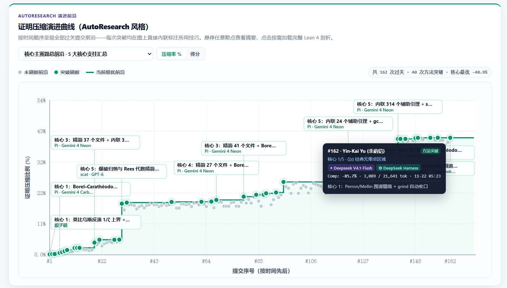
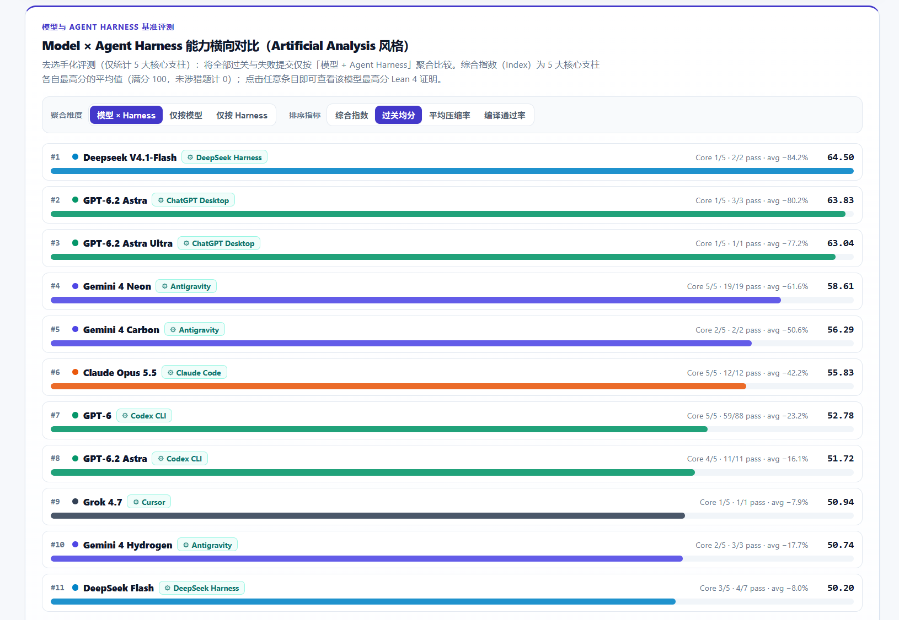
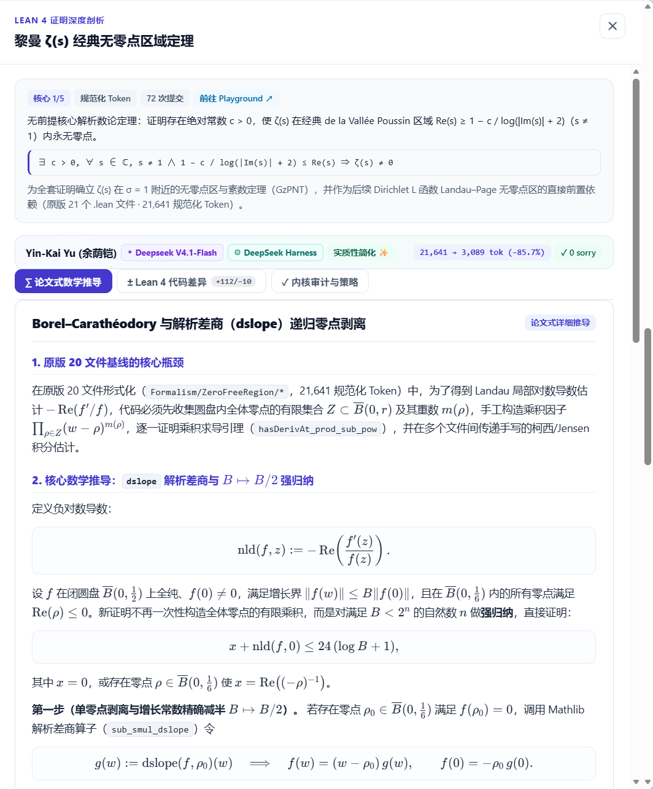

# Library-Native Proof Compression — Successive Record Formalizations of the Classical Zero-Free Region in Lean 4

**Research paper (English + 中文): how a 21-file, 21,641-token reference formalization of the classical
de la Vallée Poussin zero-free region became a single 2,931-token file — five record refreshes, each traced
to its structural insight.**

**Yin-Kai Yu (余荫铠)** · DeepSeek Harness × ChatGPT Desktop collaborative research track
<https://github.com/YinkaiYu/riemann-hypothesis-zero-free-region-lean4>

[](https://lean-lang.org/)
[](https://github.com/leanprover-community/mathlib4)
[](docs/EVIDENCE.md)
[](docs/EVIDENCE.md)
[](LICENSE)

**Paper:** [**English**](paper/main_en.md) · [**中文版**](paper/main_zh.md) · **Cite:** [`CITATION.cff`](CITATION.cff) ·
[`paper/references.bib`](paper/references.bib)

---

## The record sequence (each `kept = true` on the public curve)

| record | attempt | artifact | tokens | official score | `running_best_pct` | structural advance |
|---:|---|---|---:|---:|---:|---|
| — | 96263 | previous holder (Pi) | 3,286 | 64.5215 | 85.68 | — |
| 1 | 96272 | [`Lean/record-96272/`](Lean/record-96272/) | 3,274 | 64.5332 | 85.73 | prescribed witness gap; rebalanced weighted certificate |
| 2 | 96276 | [`Lean/fixes/localcert-fix/`](Lean/fixes/localcert-fix/) | 3,208 | 64.6400 | 86.03 | local certificate; adaptive scale `a = Re s + 5d`, `d = 2⁻²⁰/log R` |
| 3 | 96281 | [`Lean/record-96281/`](Lean/record-96281/) | 3,065 | 64.8928 | 86.64 | root-window reorganization at the pole side |
| 4 | 96282 | [`Lean/record-96282/`](Lean/record-96282/) | 3,014 | 64.9800 | 86.87 | fused windows; sharp pole bound `|Im z|⁻¹` |
| 5 | 96283 | [`Lean/smallest-scored-96283/`](Lean/smallest-scored-96283/) | **2,931** | **65.1339** | **87.24** | one complex identity carried through the assembly |

**External validation.** The benchmark's *model × harness* leaderboard ranks **Deepseek V4.1-Flash +
DeepSeek Harness #1** by composite index (**64.50**) and by average proof compression (**84.2 %**)
(`evidence/figures/leaderboard-model-harness.png`, `leaderboard-avg-compression.png`). The first record
moment is archived as a screenshot (`evidence/figures/curve-record-162-submission.png`: submission #162,
−85.7 %, 3,089 site tokens, 2026-11-22 05:23), and the platform's paper-style derivation of the technique
— *Borel–Carathéodory + analytic divided difference (`dslope`) recursive zero peeling* — in
`evidence/figures/site-derivation-borel-dslope.png`; submission-progress overview in
`evidence/figures/submission-progress.png`.




**Compression:** 21,641 → 2,931 normalized tokens (−86.5 %) in one file. The mathematical core is the same
throughout — a Mellin entire formula for `(s−1)ζ(s)` (growth + cheap zero exclusion near `s = 1`), a
recursive **zero-peeling lemma** (analytic divided difference `dslope` + Borel–Carathéodory) replacing finite
zero products and contour estimates, and a von Mangoldt bridge into the classical 3–4–1 inequality — and each
record step improves the *interface* between these parts or the arithmetic assembly. An ablation shows the
natural Euler–Maclaurin growth route costs **1,057** tokens versus ≈715 for Mellin (≈50 % more): the
compression is structural, not cosmetic.

**Published technique** (benchmark site, submission 96283): `core1_borel_dslope` — *Borel–Carathéodory +
Divided-Difference (DSlope) Zero Factorization* — reproduced verbatim (EN + 中文) in both papers.

---

## Repository guide

| what | where |
|---|---|
| Paper (English) | [`paper/main_en.md`](paper/main_en.md) |
| 论文（中文） | [`paper/main_zh.md`](paper/main_zh.md) |
| Five record artifacts | [`Lean/record-96272/`](Lean/record-96272/), [`Lean/fixes/localcert-fix/`](Lean/fixes/localcert-fix/), [`Lean/record-96281/`](Lean/record-96281/), [`Lean/record-96282/`](Lean/record-96282/), [`Lean/smallest-scored-96283/`](Lean/smallest-scored-96283/) |
| Smallest verified (2,843 tokens, pending) · rejected artifact | [`Lean/smallest-verified/`](Lean/smallest-verified/), [`Lean/failed-96274-v22.lean`](Lean/failed-96274-v22.lean) |
| Independent Case A/B architecture | [`research/caseAB/`](research/caseAB/) |
| Token meter + compile/axiom-audit harness | [`tools/`](tools/) |
| Official evidence snapshots | [`evidence/`](evidence/) · [`docs/EVIDENCE.md`](docs/EVIDENCE.md) |
| Extended notes | [`docs/ARCHITECTURE.md`](docs/ARCHITECTURE.md) |
| Citation metadata | [`CITATION.cff`](CITATION.cff) · [`paper/references.bib`](paper/references.bib) |

## Reproduce

```bash
python3 tools/token_count.py Lean/smallest-scored-96283/Solution.lean      # -> 2931
LEAN_HOME=/path/to/lean-4.34.1-linux MATHLIB=/path/to/mathlib4 \
  tools/compile_solution.sh Lean/smallest-scored-96283/Solution.lean demo
#   expected: compile rc=0;  #print axioms -> [propext, Classical.choice, Quot.sound]
```

## Provenance

The results were produced under the account *Yin-Kai Yu (余荫铠)* by a collaborative research track in which
two AI agent tracks worked together (DeepSeek Harness / Deepseek V4.1-Flash and ChatGPT Desktop /
GPT-6.2 Astra). Rejected artifacts and pending scores are reported as such.

## How to cite

```bibtex
@misc{yu2026zfrcompress,
  author       = {Yu, Yin-Kai},
  title        = {Library-Native Proof Compression: Successive Record Formalizations of the Classical Zero-Free Region in {Lean}~4},
  year         = {2026},
  howpublished = {GitHub repository, artifact release v1.0},
  url          = {https://github.com/YinkaiYu/riemann-hypothesis-zero-free-region-lean4},
  note         = {Five record refreshes; best official score 65.1339 (submission 96283), curve kept=true},
}
```

## License

MIT — see [`LICENSE`](LICENSE). Lean/Mathlib dependencies keep their own licenses (Mathlib: Apache-2.0).
